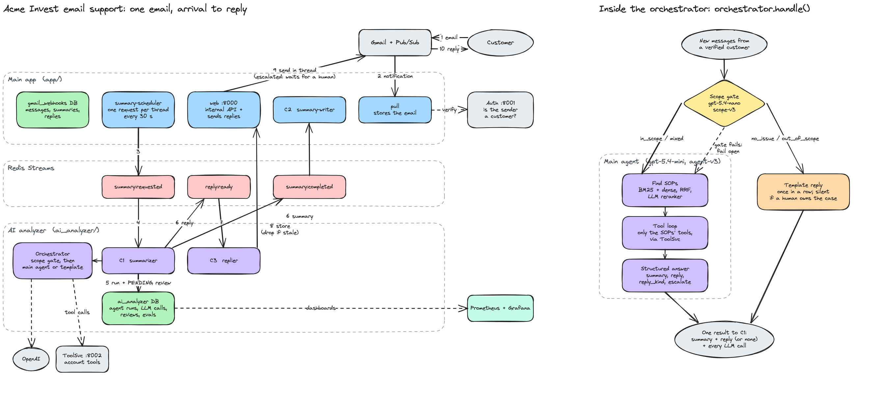
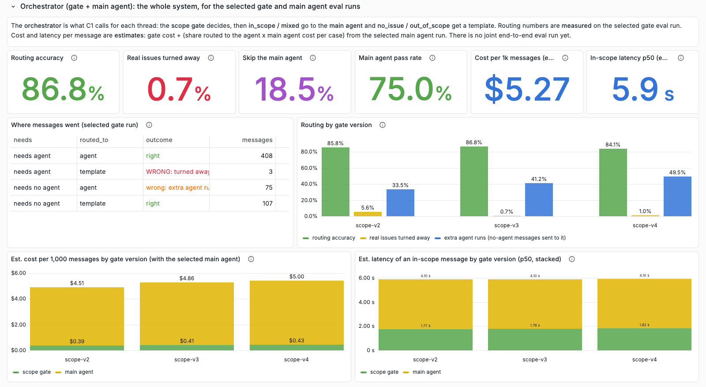
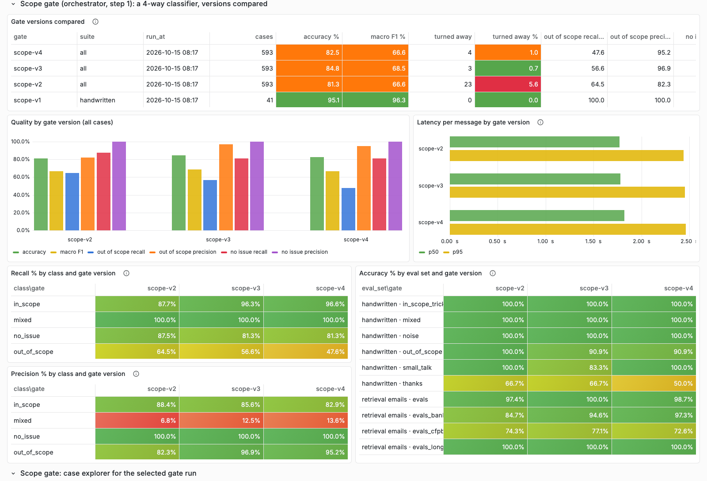

# Acme Invest email support agent

An AI support agent that answers customer emails for **Acme Invest**, a fictional Indian crypto investing app.
It reads a real Gmail inbox, works out what the customer needs, follows the company's support procedures
(SOPs), looks up the customer's own account data through tools, and replies in the same Gmail thread.
Escalations wait for a human to approve them.

Built as a portfolio project to show how an LLM agent is put into a real system: event-driven services,
security boundaries around the model, evals for every component, and monitoring of cost, latency and quality.

**Stack:** Python 3.12 · Flask · OpenAI Responses API (gpt-5.4-mini, gpt-5.4-nano, text-embedding-3-small) ·
Redis Streams · Postgres 17 + SQLAlchemy · Gmail API + Cloud Pub/Sub · Prometheus + Grafana · Docker Compose ·
pytest (201 tests)

## Results at a glance

| Component | What was measured | Result |
|---|---|---|
| SOP retrieval | hit@3 on 417 labelled emails (BM25 → dense → hybrid → hybrid + LLM reranker) | **38.6% → 68.6%**, MRR 0.33 → 0.63 |
| Scope gate | 593 cases: does each message reach the main agent or a template? | **0.7%** of real issues turned away (3 of 411); 96.9% precision when it says "out of scope" |
| Main agent | Real follow-up threads (agent-v1 → v2) | Re-answering "thanks" fixed; tokens per case **18.2k → 8.7k**, p50 **21 s → 4.1 s** |
| Whole system | Estimated cost on the eval mix of messages | about **$5.30 per 1,000 messages**; the gate costs $0.41 of that |

## How it works

```
Customer ──email──► Gmail ──Pub/Sub──► Main app ──verify sender──► Auth
                                          │  ▲
                              one request │  │ summary + reply
                              per thread  ▼  │
                                     Redis Streams
                                          │  ▲
                                          ▼  │
                                     AI analyzer ──► Orchestrator ──► OpenAI
                                                       │
                                                       └──► ToolSvc (the customer's own account data)
```

1. **Ingest.** Gmail notifies the main app through Pub/Sub. The main app stores the email and asks the Auth
   service whether the sender is a registered customer. Unknown senders are stored but never answered.
2. **Batch.** Every 30 seconds a scheduler sends one request per thread with new messages, so a burst of three
   emails becomes one agent run.
3. **Answer.** The AI analyzer (C1) calls the **orchestrator**:
   - the **scope gate** (gpt-5.4-nano) decides what kind of message it is;
   - real issues go to the **main agent** (gpt-5.4-mini): it finds the matching SOP sections, calls only the tools
     those sections list, and returns a structured answer (summary, reply, escalate);
   - thanks, greetings and out-of-scope questions get a fixed **template**, at no agent cost.
4. **Record, then publish.** C1 saves the run and a review row in its own database, then publishes the summary
   (C2 saves it) and the reply (C3 stores it).
5. **Send.** The main app sends the reply in the Gmail thread. C3 drops it if a newer message arrived meanwhile.
   Escalated replies wait until a person runs `approve`.



The full diagram, editable in Excalidraw: [`docs/architecture.excalidraw`](docs/architecture.excalidraw).

### Why each piece exists

| Piece | Why |
|---|---|
| Pub/Sub + pull worker | Gmail pushes changes; no polling, and no public URL needed |
| Scheduler + Redis Streams | One agent run per thread, not per email; consumer groups and acks mean a crash loses no work |
| C1 / C2 / C3 consumers | The AI service never writes to the main app's database; a reply is re-checked for staleness before it is stored |
| Auth service | Only registered customers get answers |
| ToolSvc | Holds the 44 account tools. The LLM never sees a `user_id`, so it cannot ask for another customer's data |
| A database per service | Agent runs, LLM calls, reviews and evals stay out of the email database |
| Prometheus + Grafana | Cost, latency and quality are measured per run and per LLM call |

## Design decisions

- **The model never holds the keys.** Tool definitions have no `user_id`. The message id comes from our code;
  ToolSvc asks the main app who owns that message and runs the tool for that customer only. Another customer's
  record ids answer "not found".
- **The SOPs decide the tools.** Each SOP section lists the tools it needs (`TOOLS:` line). The agent is offered only
  the tools of the sections retrieved for this email.
- **The gate fails open.** Turning a real customer away is the worst mistake, so when the gate is unsure, or errors,
  the message goes to the main agent. A missed out-of-scope message only costs one agent run.
- **Templates for the cheap cases.** Thanks, greetings and out-of-scope replies are fixed text: they cannot invent
  products or promises. Each is sent at most once in a row, and never while a human owns the case.
- **Humans approve escalations.** An escalated reply is stored as `awaiting_approval`; `app.cli approve` sends it,
  `reject` means it is never sent.
- **Every reply can be reviewed.** C1 writes the run (`agent_runs`, every `llm_calls` row) and a `PENDING` review
  before publishing, so no reply reaches C3 without a record a reviewer can mark `agent_was_wrong`.
- **Structured output.** The gate and the main agent answer in a strict JSON schema generated from Pydantic models,
  checked by a test against the OpenAI SDK's own strict-schema converter.
- **Prompts are versioned and evaluated.** Each prompt change bumps a version (`scope-v3`, `agent-v3`) and is measured
  on the same eval cases. scope-v4 looked like an improvement and measured worse, so it was reverted
  (every version's diff and result: [`docs/prompt_versions.html`](docs/prompt_versions.html), open it in a browser).
- **Eval cases are reviewed by people, not generated.** A person decides the correct SOP and the expected answer before
  a case enters an eval set. Generating cases with an LLM was a deliberate no: if one model writes the expected answer
  and another grades against it, the eval measures agreement between models, not correctness. Reviewing the gate's
  disagreements found **60 wrong labels** in the eval data; with them corrected, the measured "turned away" count went
  from 43 to 3.
- **Layered code.** Every service is `controllers → services → repositories / clients → models`: no SQL or HTTP calls
  in services, and each service owns its transaction.

## Evals

Every eval runner saves a results file and imports it into Postgres, so the **AI evals** Grafana dashboard compares
versions side by side.

| Eval | Cases | Main metrics |
|---|---|---|
| **Retrieval:** BM25, dense, hybrid (RRF), hybrid + LLM reranker | 558 emails: hand-written, [Banking77](https://github.com/PolyAI-LDN/task-specific-datasets), real CFPB complaints localised to India | hit@1, hit@3, MRR, latency; out-of-scope cut-offs |
| **Scope gate** | 41 hand-written threads + the 552 retrieval emails with reviewed scope labels | accuracy, macro F1, precision and recall per class, real issues turned away |
| **Main agent** | 4 real follow-up threads | deterministic checks (SOP followed, tools, escalation, reply or silence, no internal codes, not a repeat) + an LLM judge (rubric, grounded) |

| Retrieval system | hit@1 | hit@3 | MRR | p50 latency |
|---|---|---|---|---|
| BM25 | 22.8% | 38.6% | 0.331 | 0.1 ms |
| Dense (text-embedding-3-small) | 33.8% | 45.1% | 0.433 | 240 ms |
| Hybrid (RRF) | 26.9% | 46.0% | 0.400 | 242 ms |
| **Hybrid + LLM reranker** (rerank-v2) | **54.2%** | **68.6%** | **0.625** | 1.6 s |





How to run each eval: [`ai_analyzer/agent/evals/README.md`](ai_analyzer/agent/evals/README.md) and
[`docs/OPERATIONS.md`](docs/OPERATIONS.md).

## Monitoring

Two Grafana dashboards, provisioned as code from `monitoring/`:

- **AI agent:** runs, LLM calls, tokens, cached share, cost per run and per day, latency percentiles, the
  orchestrator's routing, and a drill-down for one run: a waterfall of its LLM calls, SOPs retrieved vs followed,
  tool calls, the reply and the reviewer's verdict.
- **AI evals:** the sections above, for retrieval, the orchestrator, the gate and the main agent.

Every LLM call goes through one client (`ai_analyzer/clients/llm_client.py`) that records its purpose, tokens and
latency, both to Prometheus and to the run's `llm_calls` rows. Cost is computed in SQL from `model_prices`, so
changing a price re-prices all history.

## Simpler on purpose

- **Fake account data.** ToolSvc runs on a seeded in-memory database of six demo customers. The tools and the
  ownership checks are real; the data is not.
- **One mailbox, local Docker.** No cloud deployment, no Kubernetes; the web app runs as one process.
- **Schema changes** use a short list of idempotent `ALTER … IF NOT EXISTS` statements instead of Alembic.
- **Costs are estimates** from token counts and published prices, not from the invoice.
- **The main agent's eval set is small** (4 threads). It grows from reviewed production mistakes, by hand.

## What's next

- A reviewed single-email eval suite for the main agent (safety cases, prompt injection, every SOP family).
- An end-to-end eval that runs the whole orchestrator on the same cases, instead of estimating from two runs.
- An FAQ tier: tool-free answers the gate can give directly.
- CI that re-runs the evals on every prompt change and blocks a regression in "turned away" or missed escalations.

## Run it

You need Docker, an OpenAI API key, and a Google Cloud project with the Gmail API and Pub/Sub.
**[`SETUP.md`](SETUP.md) walks through everything from a fresh clone to the first reply.** In short:

```bash
cp .env.example .env                  # fill in OPENAI_API_KEY, the Pub/Sub names, TOKEN_ENCRYPTION_KEY
docker compose up -d postgres
docker compose run --rm auth python -m auth register you@gmail.com --user-id 101   # you, as demo customer 101
docker compose up -d --build          # 13 containers
open http://localhost:8000/oauth/start   # connect the support inbox
open http://localhost:3000               # Grafana
uv run pytest                            # tests (use the stack's Postgres on localhost:5433)
```

Then email the connected inbox from the registered address. Everything else, including running the services without
Docker, the eval commands and the behaviour guarantees, is in [`docs/OPERATIONS.md`](docs/OPERATIONS.md).

## Repository

| Path | What |
|---|---|
| `app/` | Main app: Gmail ingest, scheduler, C2, internal API, sending, approvals |
| `ai_analyzer/` | C1 and C3, the orchestrator (`agent/`), retrieval (`knowledge_retriever/`), 17 SOP files with 209 sections (`sops/`), evals |
| `auth/` | Auth service: is this sender a customer? |
| `toolsvc/` | ToolSvc: 44 read-only account tools on demo data |
| `monitoring/` | Prometheus config and Grafana dashboards as code |
| `docs/` | Architecture diagram, prompt version history, [operations guide](docs/OPERATIONS.md) |

Banking77: Casanueva et al., 2020, "Efficient Intent Detection with Dual Sentence Encoders" (CC BY 4.0). CFPB
complaint narratives: the public Consumer Financial Protection Bureau complaint database (via the
`BEE-spoke-data/consumer-finance-complaints` dataset), with company and place names localised to India.
