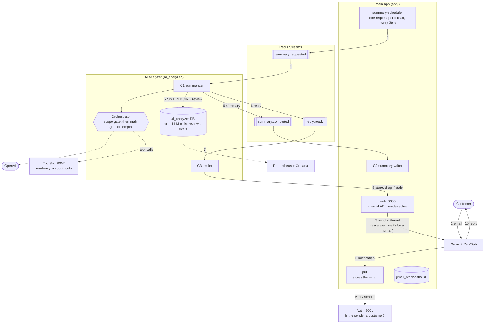
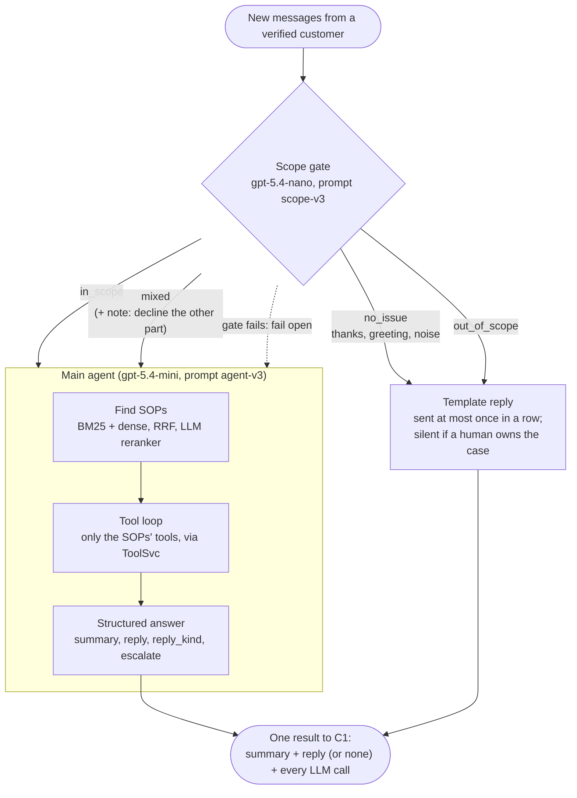

# Architecture

## The whole system

Every box is one process in `docker-compose.yml`, and each service owns its own Postgres database.
Numbers follow one customer email from arrival to reply.

## Inside the orchestrator

What C1's one call, `orchestrator.handle()`, does with a thread's new messages.

